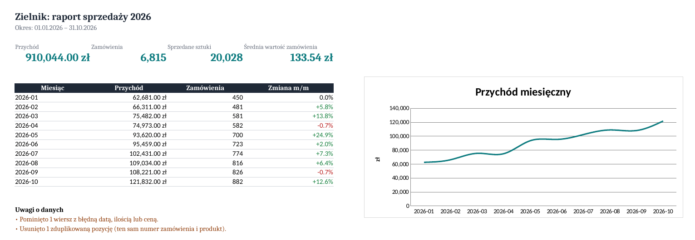

# Raport sprzedaży: Excel report automation in Python

Turns raw order exports (from an online shop, Allegro, etc.) into a **ready-to-send Excel report** in one command: summary KPIs, monthly trend, product and channel analysis, native Excel charts and a clean data table.

Typical freelance use case: *"every month I copy data from two exports into Excel and build the same report by hand, please automate it"*.



## What it does
- Reads **CSV and XLSX**, detects the delimiter (`,` or `;`) and the encoding with BOM
- Understands **Polish and English column names** (`Nr zamówienia`, `Data zamówienia`, `Cena brutto`, `order_id`…)
- Cleans the data: Polish number formats (`1 054,50 zł`), mixed date formats (`2026-03-05`, `05.03.2026`), invalid rows, duplicate line items. Every fix is listed in the report under "Uwagi o danych"
- Builds 4 sheets:
  - **Podsumowanie:** KPIs, month-by-month table with % change (green/red), line chart
  - **Produkty:** revenue per product with share and a colour scale, top-10 bar chart
  - **Kanały:** revenue per sales channel with a pie chart
  - **Dane:** cleaned data as an Excel Table (filters, banding, frozen header)
- Command line interface with clear error messages, tested with **pytest**

## Usage
```bash
pip install -r requirements.txt
python przyklad/generuj_dane.py                 # creates sample exports
python -m raport przyklad/sklep_www.csv przyklad/allegro.csv -o raport.xlsx -t "Raport sprzedaży 2026"
```
Output:
```
Gotowe: raport.xlsx (12581 pozycji, 6815 zamówień)
  uwaga: Pominięto 1 wiersz z błędną datą, ilością lub ceną.
  uwaga: Usunięto 1 zduplikowaną pozycję (ten sam numer zamówienia i produkt).
```
An example result is in [`przyklad/raport_sprzedazy.xlsx`](przyklad/raport_sprzedazy.xlsx).

## Tests
```bash
python -m pytest
```

## Tech
Python 3.10+ · pandas · openpyxl (charts, conditional formatting, tables) · pytest

---
Author: [Andrii Tsap](https://andriu-tsap.github.io). Sample data is generated.
